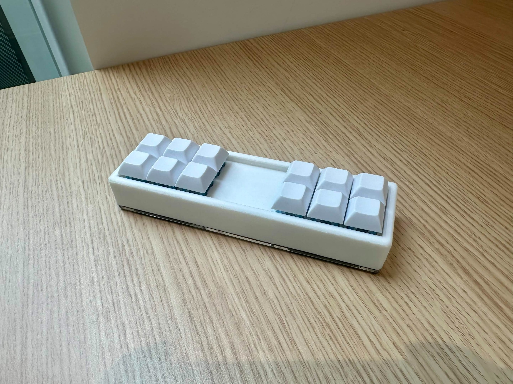
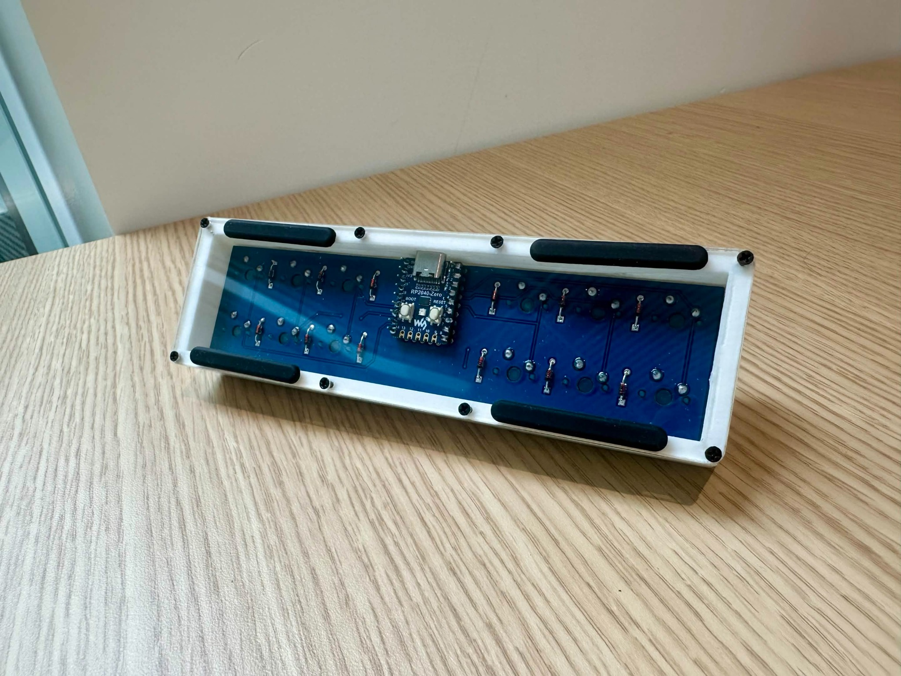
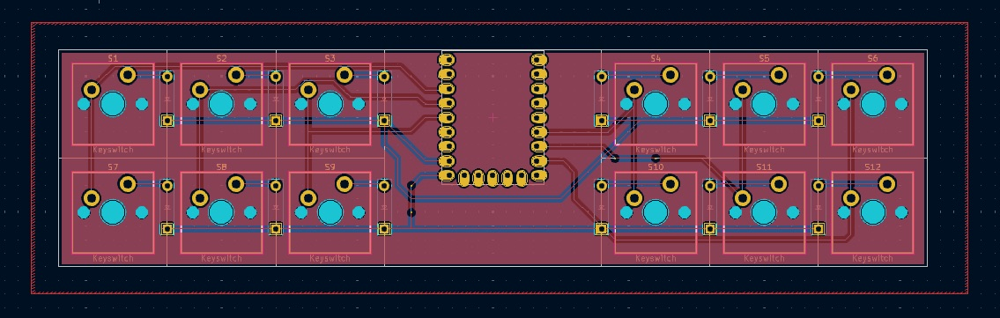
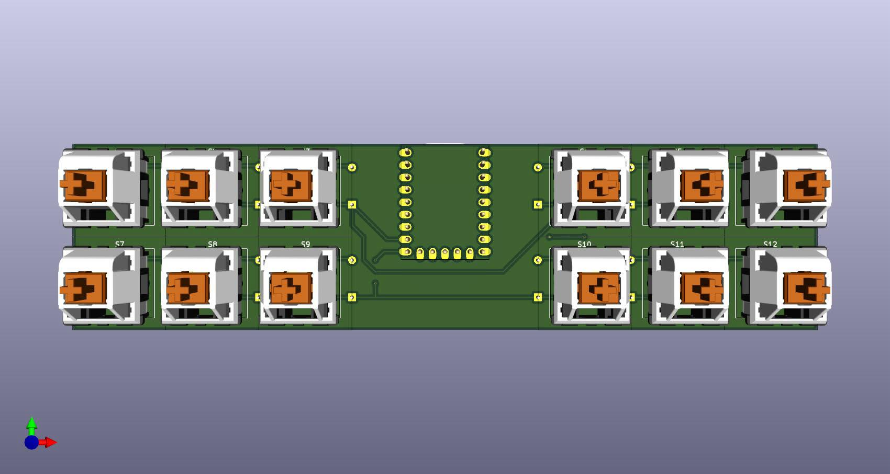
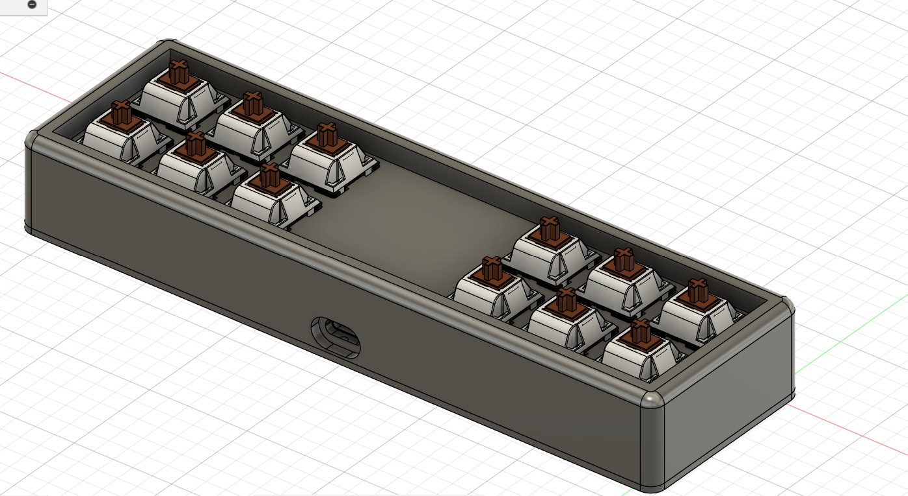
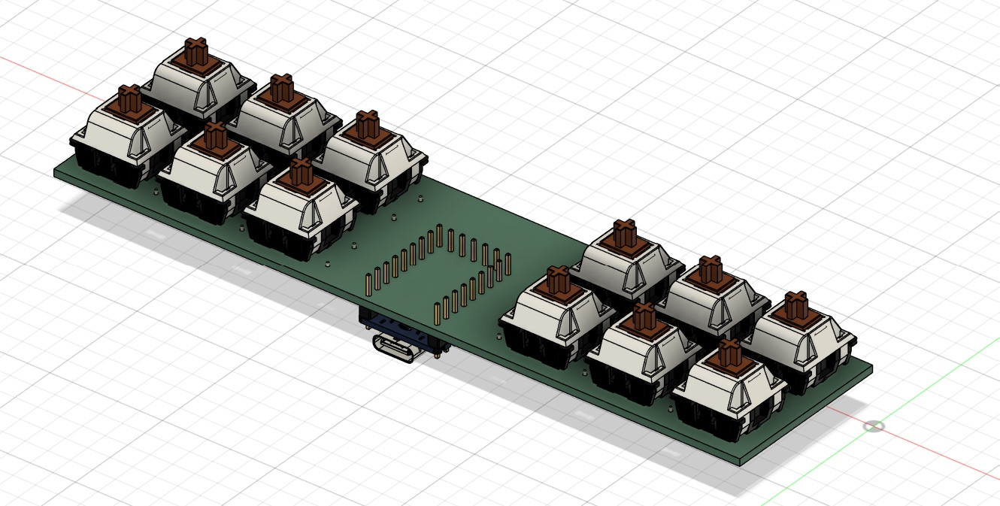

# TwinSix — Custom 12-Key Macropad

A custom 12-key mechanical macropad built around a designed PCB, an RP2040-based controller, QMK firmware, and a 3D-printed enclosure. The two 2×3 key clusters leave an open center section for the controller and create a compact, symmetrical layout.



## Overview

TwinSix is a hardware design project covering PCB layout, keyboard firmware configuration, mechanical modeling, and final assembly. The board uses a 2×6 key matrix and a centrally mounted RP2040-based controller connected over USB-C.

**Project highlights**
- Designed a custom PCB and switch layout in KiCad for 12 mechanical keys.
- Routed the switch matrix and integrated a centrally positioned controller footprint.
- Configured QMK firmware, including default key mappings and Vial-related configuration files.
- Modeled a fitted enclosure and switch openings for 3D printing.
- Assembled the PCB, mechanical switches, keycaps, and enclosure into a finished device.

## Finished build

| Top | Underside |
| --- | --- |
|  |  |

## PCB design

The PCB arranges twelve switch footprints in two groups of six, with the controller located between them. The firmware defines **2 rows and 6 columns** using RP2040 GPIO pins.

| PCB routing | 3D PCB preview |
| --- | --- |
|  |  |

The editable schematic, board layout, and project configuration are in [`hardware/kicad/`](hardware/kicad/). Fabrication outputs are in [`hardware/fabrication/`](hardware/fabrication/).

## Mechanical design

The enclosure was modeled around the PCB and switch geometry, with a recessed top opening and a USB-C access cutout. Printable STL files and a DXF drawing are included in [`mechanical/`](mechanical/).

| Enclosure CAD | Switch assembly CAD |
| --- | --- |
|  |  |

## Firmware

The project uses **QMK** on an **RP2040** controller. The firmware source in [`firmware/`](firmware/) includes matrix pin assignments, default keymap, and Vial configuration. Prebuilt UF2 firmware images from the project archive are included under [`firmware/prebuilt/`](firmware/prebuilt/).

The supplied default keymap is:

```text
Left cluster        Right cluster
  1  2  3              4  5  6
  7  8  9              0  A  B
```

For development, place the firmware files into the appropriate `keyboards/handwired/twinsix/` directory in a QMK firmware checkout. The original project documents the build command:

```bash
qmk compile -kb handwired/twinsix -km default
```

**Note:** The included firmware files are an archived project configuration, not a standalone QMK checkout. Review the board revision and firmware before flashing any UF2 image.

## Repository layout

```text
images/                Project photos and design renders
hardware/kicad/        Editable schematic and PCB design
hardware/fabrication/  PCB fabrication outputs
mechanical/            Enclosure STLs and DXF
firmware/              QMK configuration, keymaps, and UF2 files
```

## Tools and technologies

KiCad · RP2040 · QMK · Vial configuration · 3D CAD · 3D printing · Mechanical keyboard switches

## Project status

A physical prototype has been assembled. This repository preserves the hardware, mechanical, and firmware design artifacts from the build.
